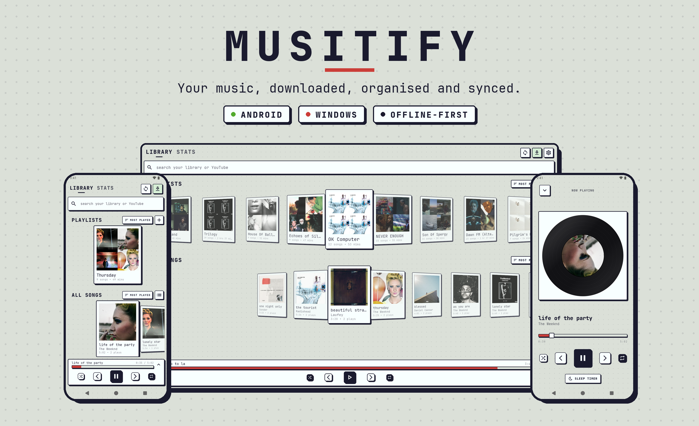
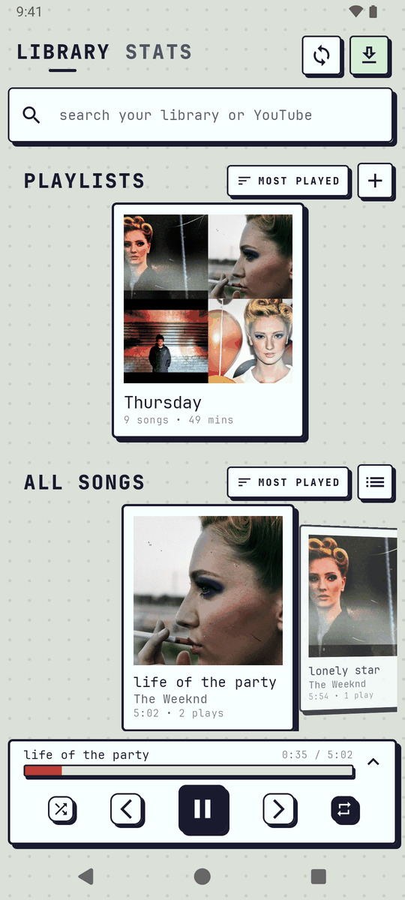
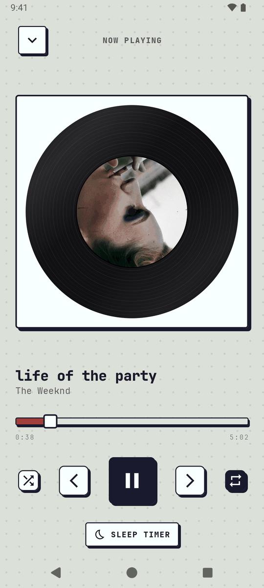
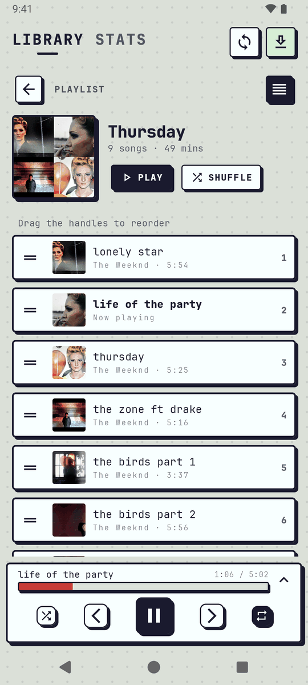
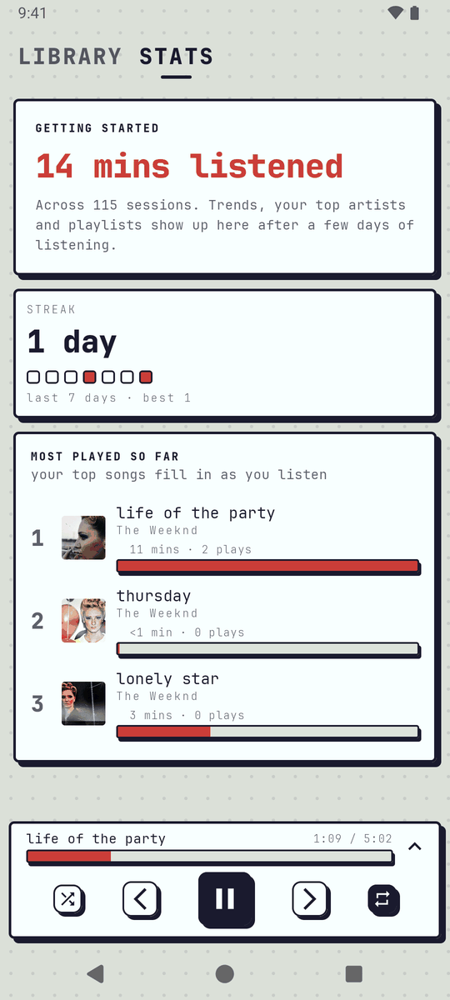
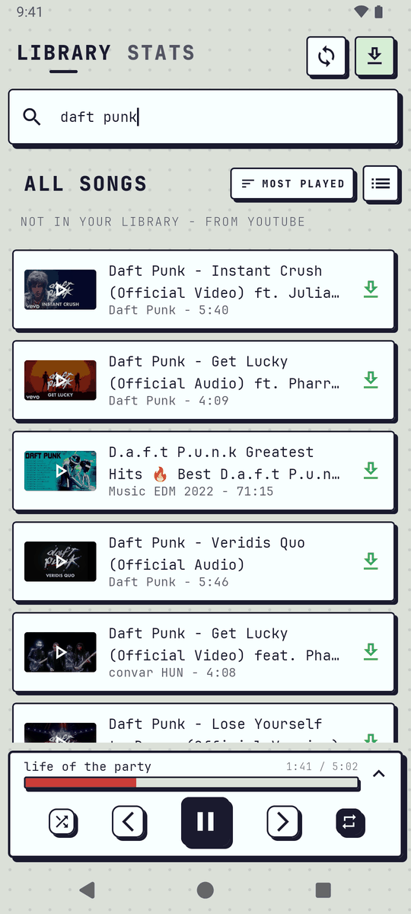
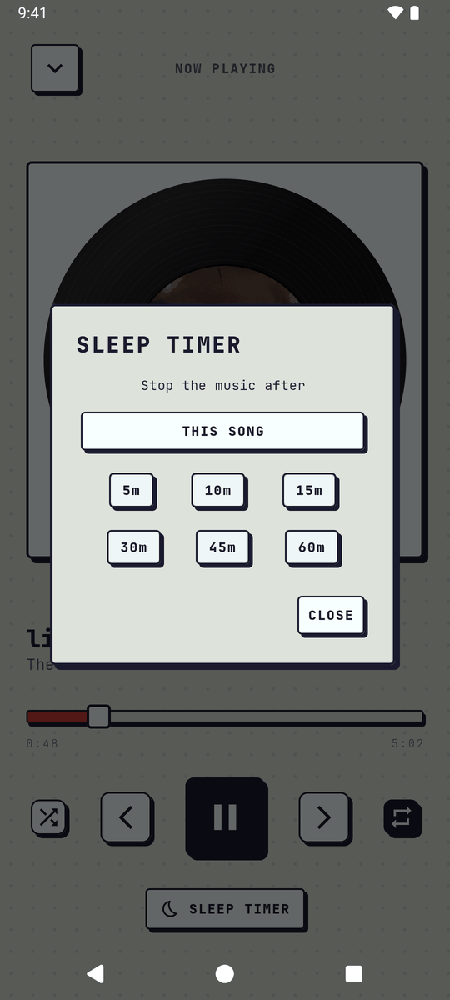
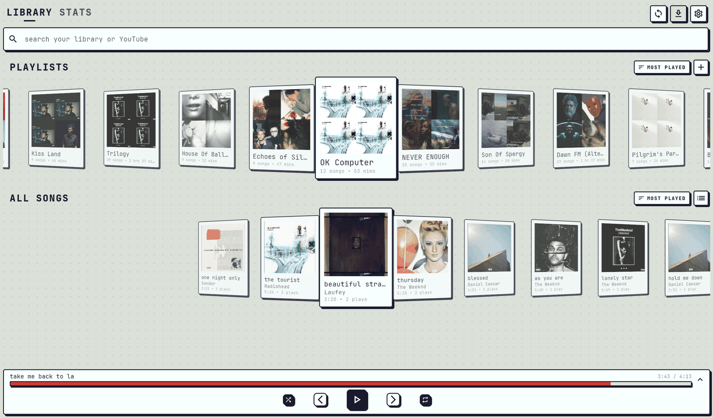
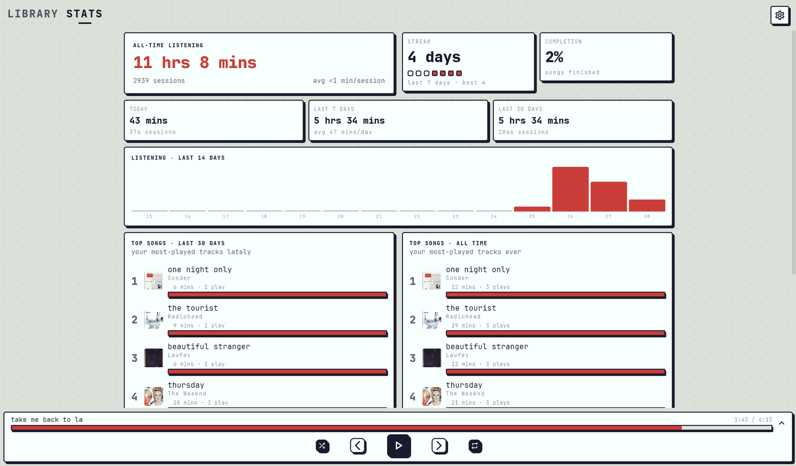

<div align="center">



<br/>

**An offline-first, self-hosted music library for Android and Windows.**

Paste a YouTube link, get a clean MP3 on your device, organise it into playlists,
and keep your library in sync across every machine you own.


[Features](#features) ·
[Screenshots](#screenshots) ·
[Architecture](#architecture) ·
[Getting started](#getting-started) ·
[Sync](#sync-server) ·
[Project structure](#project-structure) ·
[Roadmap](#roadmap)

</div>

---

## Why Musitify?

Streaming apps rent you music. Musitify lets you **keep** it.

- **Your files, your device.** Every song is a real MP3 on disk, playable with no connection.
- **No account and no cloud lock-in.** Sync runs through a small server you host yourself.
- **One library, two platforms.** The Android and Windows apps share the same Room schema, the same sync protocol and the same look.

---

## Features

### Downloading
- Download a single **YouTube video** or a whole **YouTube playlist** from a pasted link. The app detects which one you pasted.
- **YouTube search fallback**: if a search finds nothing in your library, Musitify searches YouTube, shows a preview, and queues the result with one tap.
- Audio is pulled with **yt-dlp** and converted to **MP3** (`libmp3lame`, VBR quality 0) with **FFmpeg**.
- Album art is saved with every track.
- **Title cleanup** removes noise like `(Official Video)`, `[Lyrics]` and `(HD)`, and keeps version tags such as *Live*, *Remastered* and *Acoustic*.
- Artist lookup falls back through `artist` → `artists` → `uploader` → *Unknown Artist*.
- A live **Downloads panel** shows progress by song name and clears itself when finished.
- Retries with backoff, URL-based **deduplication**, and **reuse of songs already in your music folder** (Windows).

### Playback
- Background playback with lock-screen, notification, Bluetooth and headset controls (Media3 `MediaSessionService` on Android).
- Play/pause, next/previous, **shuffle**, and **repeat** (off → all → one).
- **Sleep timer**: stop after a set time, or after the current song.
- A full-screen **Now Playing** view with a spinning, Canvas-drawn **vinyl record** carrying the album art.

### Library and playlists
- 3D **cover-flow carousels** for playlists and songs, plus a list view.
- Create, rename and delete playlists. Add songs one at a time or in bulk.
- **Drag to reorder** songs inside a playlist.
- Automatic **2×2 collage covers** for playlists.
- Rename songs, edit artists, and add to playlists from a context menu (long-press on Android, right-click on Windows).
- Sort by date added or play count, in either direction. Debounced search sits pinned in the top bar.

### Listening stats
- All-time listening time, sessions and average session length.
- **Streaks** (current and longest) with streak dots.
- Today, this week and this month totals, plus a **14-day listening chart**.
- **Top songs** for the month and a song completion rate.
- A dedicated first-week view so new libraries don't show empty charts.

### Cross-device sync
- **Action-based sync**: every change (like, playlist create/delete, add/remove, rename, reorder) is written to an outbox and pushed to the server. Other devices pull it with a cursor.
- **Snapshot sync** uploads or downloads a whole library, which is useful for first-time setup.
- Songs that arrive from another device are **downloaded automatically** from their source URL.

### Windows extras
- Global **media keys**. Keyboard shortcuts: <kbd>Space</kbd> play/pause, <kbd>←</kbd>/<kbd>→</kbd> seek 5 s, <kbd>Ctrl</kbd>+<kbd>←</kbd>/<kbd>→</kbd> previous/next, <kbd>Ctrl</kbd>+<kbd>R</kbd> repeat, <kbd>Esc</kbd> back.
- Minimises to the **system tray** and keeps playing.
- Side-panel player on wide windows.
- Settings for the server URL, music folder location and manual sync.

---

## Screenshots

### Android

<div align="center">

| Library | Now playing | Playlist | Stats |
|:---:|:---:|:---:|:---:|
|  |  |  |  |
| **YouTube search** | **Sleep timer** | | |
|  |  | | |

</div>

### Windows

<div align="center">



<br/><br/>



</div>

### Design: Tracknix

The interface uses **Tracknix**, a neo-brutalist design system: thick black borders, hard offset shadows with no blur, a sage and coral palette, a dot-grid background and **JetBrains Mono** throughout. Buttons sink into their shadow when pressed. Carousels scale, tilt and fade cards based on their distance from the centre of the screen.

---

## Architecture

Both apps follow **MVVM** on top of a repository layer. The UI never talks to the database, the player or the network directly.

```
┌──────────────────────────────────────────────────────────────┐
│  UI         Jetpack Compose / Compose Desktop  +  ViewModels │
├──────────────────────────────────────────────────────────────┤
│  Domain     Song · Playlist · Settings · Action · Stats      │
│             · MediaController repositories                   │
├──────────────────────┬───────────────────────────────────────┤
│  Local store         │  Engines                              │
│  Room (SQLite)       │  yt-dlp · FFmpeg · audio player       │
├──────────────────────┴───────────────────────────────────────┤
│  Network    OkHttp + kotlinx.serialization → sync server     │
└──────────────────────────────────────────────────────────────┘
```

### Platform implementations

| Concern | Android | Windows |
|---|---|---|
| UI | Jetpack Compose, Material 3 | Compose Multiplatform Desktop 1.12 |
| Dependency injection | Hilt | Koin |
| Database | Room 2.8.4 | Room 2.8.4 + bundled SQLite (same schema) |
| Downloader | yt-dlp inside the app via **Chaquopy** (Python 3.14) | Bundled `yt-dlp.exe` |
| Audio conversion | FFmpegKit (`ffmpeg-kit-next` 8.1.0) | Bundled `ffmpeg.exe` / `ffprobe.exe` |
| Playback | Media3 ExoPlayer in a foreground `MediaSessionService` | JavaFX Media |
| Images | Coil 2 | Coil 3 |
| Media keys | MediaSession | JNativeHook |
| Networking | OkHttp 5.4 + kotlinx.serialization | OkHttp 5.4 + kotlinx.serialization |

### Data model

```
Song ──< SongToPlaylist >── Playlist        Settings (key/value)
 id, uuid, url (unique)       position         device id, sync cursor, flags
 name, artist, length         addedOn
 filePath, artPath                          SyncAction (outbox)
 timeHeard, downloadedAt                       uuid, type, payload, synced, createdAt
```

Songs are identified across devices by **URL**. Songs, playlists and actions all use client-generated **UUIDs**, so devices can create data offline without conflicts.

### Listen tracking
While a song is playing, the player position is polled every 500 ms. Every ~7 s the time listened is added to both the song and the current playlist. Each update is capped so a seek can't inflate the total. Play count is calculated as `round(timeHeard / length)`.

---

## Getting started

### Prerequisites

| | Android | Windows |
|---|---|---|
| JDK | 11+ (Android Studio's bundled JBR works) | 17 |
| IDE | Android Studio (AGP 9.2) | IntelliJ IDEA or Android Studio (optional) |
| Other | **Python 3.14** installed locally, which Chaquopy uses at build time | An internet connection on the first build |
| Device | Android 7.0 (API 24) or newer | Windows 10 / 11 |

### Clone

```bash
git clone https://github.com/yath-rth/Musitify.git
cd Musitify
```

### Android

1. Install Python 3.14. The build expects it at `C:/Python314/python.exe`. If yours is somewhere else, change `buildPython(...)` in [`Android/app/build.gradle.kts`](Android/app/build.gradle.kts).
2. Open the `Android/` folder in Android Studio and let Gradle sync.
3. Run the `app` configuration on a device or emulator, or use the command line:

```bash
cd Android
./gradlew installDebug
```

> FFmpegKit is vendored as a local AAR in `Android/app/libs/` and `Android/bundle-android-aar-24-maven/`, so it needs no extra download.

### Windows

```bash
cd Windows
./gradlew run                  # run from source
./gradlew createDistributable  # portable build → build/compose/binaries/main/app/Musitify/Musitify.exe
./gradlew packageMsi           # installer      → build/compose/binaries/main/msi/Musitify-1.0.0.msi
```

The first build downloads `yt-dlp.exe`, `ffmpeg.exe` and `ffprobe.exe` into `Windows/bin/`, which is git-ignored. If GitHub can't be reached, put those three files in `bin/` yourself.

| What | Where |
|---|---|
| Database, covers, settings | `%APPDATA%\Musitify\` |
| MP3s and thumbnails | `%USERPROFILE%\Music\Musitify\` (you can change this in Settings) |

---

## Sync server

Musitify syncs through a small self-hosted REST server. It runs on port `8080` by default and currently serves a single user with no authentication.

| Method | Path | Purpose |
|---|---|---|
| `POST` | `/sync/bootstrap` | Upload a device's entire library |
| `GET` | `/sync` | Download the entire library |
| `POST` | `/actions` | Push a batch of local actions |
| `GET` | `/actions?lastFetchedActionId=<n>` | Pull actions recorded after a cursor |

**Connecting a device**

| Setup | Server URL |
|---|---|
| Windows, same machine | `http://localhost:8080` (Settings → Server URL) |
| Android emulator | `http://10.0.2.2:8080` |
| Android over USB | Run `adb reverse tcp:8080 tcp:8080`, then use `http://localhost:8080` |
| Same Wi-Fi | `http://<laptop-ip>:8080` |

> Timestamps are milliseconds since the Unix epoch (UTC). Every request body is JSON. Field naming follows each payload's documented schema.

---

## Project structure

```
Musitify/
├── Android/                         # Android app (Jetpack Compose)
│   ├── app/src/main/
│   │   ├── python/downloader.py     # yt-dlp wrapper run through Chaquopy
│   │   └── java/com/yatharth/musitify/
│   │       ├── data/                # Room entities, DAOs, migrations, repositories, ViewModels
│   │       ├── network/             # Snapshot and action sync clients
│   │       ├── service/             # Remote change applier, sleep timer, ID manager
│   │       ├── music/               # MediaSessionService + ExoPlayer
│   │       ├── util/                # FFmpeg conversion, cover collages, title normaliser
│   │       └── ui/                  # Screens (Home, Now Playing, Stats), Tracknix elements, theme
│   └── docs/                        # Technical reference and feature list
│
├── Windows/                         # Windows desktop app (Compose Multiplatform)
│   ├── src/main/kotlin/…/musitify/
│   │   ├── data/                    # Same Room schema, repositories
│   │   ├── engine/                  # yt-dlp / FFmpeg process runners, audio player, listen tracker
│   │   ├── network/                 # Sync clients
│   │   ├── platform/                # Tray, media keys, file locations
│   │   └── ui/                      # Desktop screens and Tracknix components
│   ├── src/test/                    # Unit and smoke tests
│   ├── schemas/                     # Exported Room schema
│   └── docs/map/                    # Map of the port: data, engine, sync, UI
│
└── docs/screenshots/                # README images (hero banner and app screenshots)
```

---

## Testing

```bash
# Windows: unit tests for repositories, stats, the sync client, the title normaliser and more
cd Windows && ./gradlew test

# Android
cd Android && ./gradlew testDebugUnitTest
```

Some Windows smoke tests are **opt-in** because they use real binaries and the network. Turn them on with environment variables:

| Variable | Enables |
|---|---|
| `MUSITIFY_SMOKE_DIR` (and optionally `MUSITIFY_SMOKE_URL`) | A real yt-dlp + FFmpeg download into that folder |
| `MUSITIFY_PLAYER_SMOKE` | Playing the given audio file through the real player |

---

## Further reading

- [Android technical reference](Android/docs/description.md): architecture, the download pipeline, the database and the playback engine in detail.
- [Android feature list](Android/docs/features.md)
- [Windows README](Windows/README.md) and the [port map](Windows/docs/map/)

---

## Roadmap

- [ ] Authentication and multiple users on the sync server
- [ ] Publish the sync server alongside the clients
- [ ] Signed release builds (APK / MSI) on GitHub Releases
- [ ] Conflict handling for edits made on two devices at once
- [ ] Lyrics and richer metadata

---

## Contributing

Issues and pull requests are welcome. Before you open a PR:

1. Branch from `main`.
2. Keep commits small and focused, using [Conventional Commits](https://www.conventionalcommits.org/) with a platform scope, for example `feat(android): …` or `fix(windows): …`.
3. Run the tests for the platform you changed.
4. Add screenshots for any UI change.

---

## Disclaimer

Musitify is a personal project for managing audio you have the right to download. Respect YouTube's Terms of Service and the copyright laws where you live. The authors are not responsible for how the software is used.

## License

No license has been chosen yet. Until one is added, all rights are reserved by the author.

## Acknowledgements

- [yt-dlp](https://github.com/yt-dlp/yt-dlp)
- [FFmpeg](https://ffmpeg.org/) and [FFmpegKit](https://github.com/arthenica/ffmpeg-kit)
- [Chaquopy](https://chaquo.com/chaquopy/)
- [Jetpack Media3](https://developer.android.com/media/media3)
- [Compose Multiplatform](https://www.jetbrains.com/compose-multiplatform/)
- [JetBrains Mono](https://www.jetbrains.com/lp/mono/)

<div align="center">

Made with Kotlin by [Yatharth](https://github.com/yath-rth)

</div>
